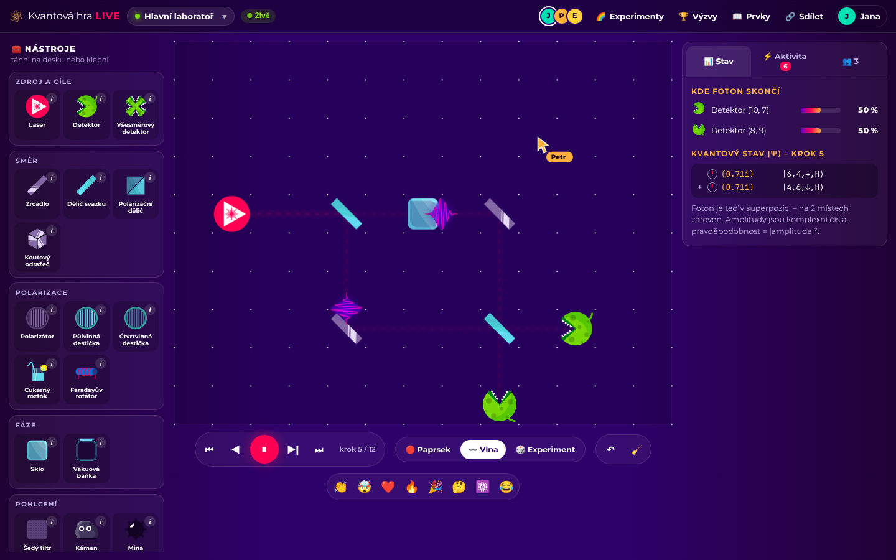
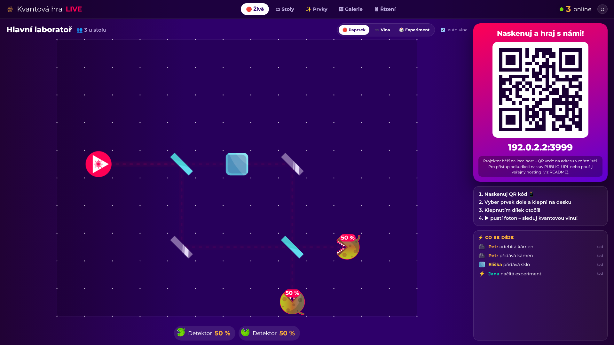
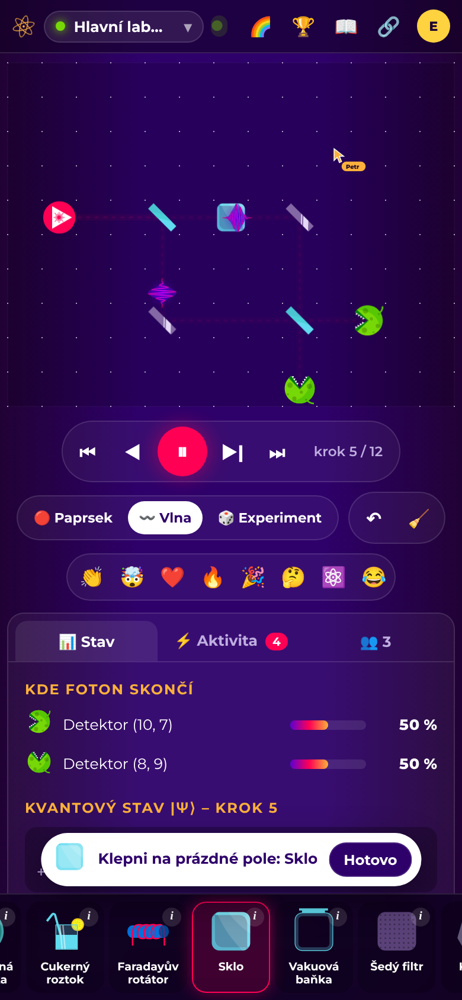
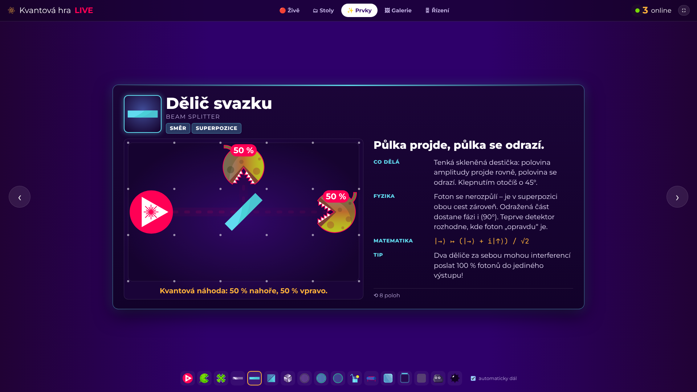

# ⚛️ Kvantová hra LIVE

**Společná kvantová laboratoř pro přednášku *„Cesta ke kvantu z pohledu obyčejného studenta“*.**
Remake hry [Quantum Game with Photons](https://quantumgame.io), ve kterém může celý sál najednou –
přes QR kód z mobilu – stavět optické experimenty s jednotlivými fotony a vidět, co dělají ostatní, v reálném čase.



| Projektor s QR kódem | Mobil (připojení přes QR) | Přehlídka prvků (jako schopnosti v LoL) |
| --- | --- | --- |
|  |  |  |

## Co to umí

- **Fyzika 1:1 s originálem.** Simulace je přepsaná z knihovny `quantum-tensors`, kterou používá Quantum Game 2.
  Test porovnává všech 36 klasických levelů s referenčními výsledky originální knihovny (shoda na 10⁻⁹).
- **17 optických prvků** s původní grafikou: laser, zrcadlo, dělič svazku, polarizační dělič, koutový odražeč,
  detektory, kámen, mina, šedý filtr, polarizátor, čtvrt- a půlvlnná destička, cukerný roztok, Faradayův rotátor, sklo, vakuová baňka.
- **Realtime spolupráce jako na Canvě:** každý, kdo načte QR kód, může přidávat, otáčet, posouvat a mazat prvky.
  Vidíš kurzory ostatních (i co zrovna táhnou), každá změna se rozbliká barvou a jménem autora, je tu panel aktivity a emoji reakce.
- **Karty prvků ve stylu „ukázky schopností“ z LoL:** najetí myší / podržení prstu ukáže kartu s animovanou mini-ukázkou
  (foton letí přes prvek do detektorů) a vysvětlením *Co dělá / Fyzika / Matematika / Tip*.
- **Tři režimy zobrazení:** 🔴 paprsek (kudy světlo teče + pravděpodobnosti), 〰️ vlna (foton jako vlnový balíček krok po kroku,
  včetně stavu |ψ⟩ v Diracově zápisu) a 🎲 experiment (opakované výstřely – detektory náhodně cvakají).
- **Slavné experimenty na jedno kliknutí:** Mach–Zehnderův interferometr, test bomby (Elitzur–Vaidman), paradox tří polarizátorů,
  polarizační třídička, kvantová kostka.
- **36 levelů (výzev)** z původní hry, přeložené do češtiny – lze je hrát společně u stolu.
- **Místnosti (stoly):** všichni začínají v *Hlavní laboratoři*, kdokoli si může založit vlastní stůl a pozvat ostatní QR kódem.
- **Projektor** (`/present`): velký QR kód, živá deska, přehled všech stolů, aktivita napříč stoly, emoji, automatické přehrávání vlny,
  přehlídka prvků a ovládání pro přednášejícího (zámek desky, oznámení všem, načtení experimentu/levelu).
- **Sdílení:** odkaz na místnost (s QR), odkaz s celou sestavou (otevře se jako vlastní kopie), společná **galerie** (`/galerie`), export/import `.json`.
- **Vydrží celý den:** stav se průběžně ukládá na disk. Když server zaspí nebo se restartuje bez disku (free hosting),
  první připojený prohlížeč mu stav desky vrátí. Bez serveru appka sama přepne do offline režimu.

## Rychlý start (na vlastním počítači)

Potřebuješ [Node.js 18+](https://nodejs.org).

```bash
npm install
npm start
```

V konzoli se vypíše:

```
  ⚛️  Kvantová hra LIVE běží!
  Hráči:        http://localhost:3000/
  Projektor:    http://localhost:3000/present?key=a1b2c3
  V místní síti: http://192.168.0.42:3000/
```

- **Hráči** otevřou `/` (nebo naskenují QR kód z projektoru).
- **Projektor** otevři s klíčem z konzole – klíč ti dá ovládání (zámek, oznámení…). Po načtení zmizí z adresního řádku, takže ho publikum neuvidí.
- Stálý klíč nastavíš proměnnou `ADMIN_KEY`, jinak se při každém startu vygeneruje nový.

## Nasazení na internet (aby to běželo celý den)

Na přednášce bývá Wi-Fi s izolovanými klienty, takže **doporučuju veřejnou adresu**. Tři možnosti:

### A) Render.com – zdarma, bez karty (doporučeno)

1. Kód je na GitHubu v `alwwex/quantumgame`. Render nasazuje výchozí větev – pokud to není ta s tímto kódem,
   sluč ji do `main` (nebo v Renderu při zakládání vyber správnou větev).
2. Otevři <https://render.com/deploy?repo=https://github.com/alwwex/quantumgame> – Render načte `render.yaml` a založí službu.
3. Po nasazení dostaneš adresu typu `https://kvantova-hra-live.onrender.com`.
   Klíč pro projektor najdeš v Render → služba → *Environment* → `ADMIN_KEY`.
4. Projektor: `https://kvantova-hra-live.onrender.com/present?key=…` – QR kód se vygeneruje sám na správnou adresu.

Poznámky k free tarifu:
- Služba po ~15 min bez návštěv **usne** a první načtení pak trvá ~30–60 s. Před přednáškou ji „probuď“ otevřením stránky.
  Aby vydržela vzhůru celý den, nastav si zdarma [UptimeRobot](https://uptimerobot.com) (HTTP monitor na `/healthz` každých 5 min).
- Disk na free tarifu se při restartu maže. Rozehrané desky se obnoví z prohlížečů připojených lidí; galerie se ale smaže –
  pokud ji chceš mít trvale, přidej si v Renderu *Persistent Disk* a nastav `DATA_DIR` na jeho cestu (placené), nebo použij variantu B/C.

### B) Z vlastního notebooku přes Cloudflare Tunnel (zdarma, bez účtu)

```bash
npm start
# v druhém terminálu (nainstaluj cloudflared: https://developers.cloudflare.com/cloudflare-one/connections/connect-networks/downloads/)
cloudflared tunnel --url http://localhost:3000
```

Cloudflared vypíše adresu `https://něco-náhodného.trycloudflare.com`. **Projektor otevři přes tuto adresu**
(`…/present?key=…`), QR kód pak povede ven na internet. Notebook musí běžet celou dobu.

### C) Docker / vlastní server

```bash
docker build -t kvantova-hra .
docker run -p 3000:3000 -e ADMIN_KEY=tajnyklic -e PUBLIC_URL=https://moje.domena.cz -v kvantova-data:/data kvantova-hra
```

### Proměnné prostředí

| Proměnná | Význam | Výchozí |
| --- | --- | --- |
| `PORT` | port serveru | `3000` |
| `ADMIN_KEY` | klíč pro ovládání projektoru (`/present?key=…`) | náhodný při každém startu |
| `PUBLIC_URL` | veřejná adresa pro QR kód (když ji server nezná sám, např. za proxy) | adresa, přes kterou je otevřen projektor |
| `DATA_DIR` | kam se ukládají místnosti a galerie | `./data` |

## Jak to použít na přednášce (blok 15+ minut)

1. **Před přednáškou:** otevři projektor (`/present?key=…`) a dej celou obrazovku (klávesa **F**). V záložce *Řízení* můžeš
   nechat QR kód vést do *Hlavní laboratoře*.
2. **Zatímco se lidé připojují (2–3 min):** přepni na **✨ Prvky** – automaticky se střídají karty prvků s animovanými ukázkami.
   Nahoře vidíš, kolik lidí je online.
3. **Volné hraní (5 min):** záložka **🔴 Živě**. Lidé stavějí v hlavní laboratoři, ty komentuješ. Když se 4,5 s nic nemění,
   projektor sám pustí vlnu fotonu. Reakce (👏🤯🔥) létají přes plátno se jmény.
4. **Řízený experiment (5 min):** *Řízení → Načíst experiment → Mach–Zehnderův interferometr*. Ukaž, že 100 % jde do jednoho
   detektoru, a vyzvi publikum: „Kdo dá do jedné cesty sklo?“ → 50 : 50. Pak *Test bomby* a režim **🎲 Experiment** – detektory
   náhodně cvakají a z mnoha výstřelů vyjde pravděpodobnost.
5. **Když je chaos:** *Řízení → 🔒 Zamknout* (deska je jen ke čtení), případně ↶ *Vrátit* poslední velkou změnu (vyčištění, načtení).
6. **Výzvy u stolů:** ať si lidé přes *Výzvy → Nový stůl* zahrají levely ve skupinkách; v záložce **🗂 Stoly** vidíš všechny stoly živě
   a kliknutím kterýkoli ukážeš na plátně.
7. **Na konci:** *Řízení → Oznámení všem*: „Uložte si výtvory do galerie!“ a ukaž **🖼 Galerii**. Web nech běžet celý den.

## Ovládání

| Akce | Myš | Dotyk (mobil) |
| --- | --- | --- |
| Položit prvek | přetáhnout z nástrojů, nebo kliknout na nástroj a pak na pole | klepnout na nástroj dole, pak na pole (nebo táhnout nahoru) |
| Otočit | kliknout na dílek (nebo **R**) | klepnout na dílek |
| Posunout | přetáhnout | přetáhnout |
| Odebrat | přetáhnout mimo desku (nebo **Delete**) | přetáhnout mimo desku / v kartě 🗑 |
| Co to dělá? | najet myší / pravé tlačítko / **i** | podržet prst / ⓘ u nástroje |
| Polarizace laseru | v kartě laseru, **Alt+klik** nebo **P** | v kartě laseru |
| Přehrávání | **mezerník**, **←/→**, **Home/End**, režimy **1/2/3** | tlačítka pod deskou |

Projektor: **F** celá obrazovka, **1–5** záložky, **←/→** v přehlídce prvků, **mezerník** pustí vlnu.

## Jak funguje fyzika

Stav fotonu je komplexní vektor nad bázemi |x, y, směr, polarizace⟩ (4 směry × 2 polarizace na každém poli).
Každý krok simulace:

1. **šíření** – každá amplituda se posune o jedno pole ve svém směru (co opustí desku, je „mimo desku“),
2. **interakce** – na polích s prvkem se lokální 8×8 operátor (směr ⊗ polarizace) vynásobí s amplitudami,
3. **měření** – úbytek |amplituda|² na poli = pravděpodobnost, že tam foton skončil (detektor cvakne, mina vybuchne…).

Operátory (zrcadlo s fází π pro V, dělič s fází *i* pro odraženou část, polarizační dělič, Faradayův rotátor…)
odpovídají `quantum-tensors` 0.4.13 – viz `public/js/qt.js` a test `test/engine.test.js`.
Jediný rozdíl: polarizace laseru v levelech se bere ve stupních (0° = H, 90° = V), jak bylo zamýšleno v klasické verzi hry.
Více laserů na jedné desce = každý střílí vlastní foton, výsledky se sčítají.

## Struktura projektu

```
server/server.js        HTTP + WebSocket server, místnosti, ukládání, QR kódy, galerie, řízení
public/index.html       aplikace pro hráče          public/js/app.js
public/present.html     projektor                    public/js/present.js
public/gallery.html     galerie výtvorů
public/js/qt.js         kvantový engine (sdílený s testy)
public/js/room-core.js  model desky a validace operací (sdílený se serverem)
public/js/board.js      vykreslení desky, paprsků, fotonů, kurzorů, drag & drop
public/js/photon.js     vlnový balíček fotonu (port z originálu)
public/js/cards.js      karty prvků s animovanou ukázkou
public/js/elements.js   české názvy a vysvětlivky prvků, ukázkové desky
public/js/templates.js  slavné experimenty
public/js/levels-data.js 36 klasických levelů
test/                   testy (node --test)
```

## Testy

```bash
npm test
```

Testují fyziku (shoda s originální knihovnou na všech 36 levelech, interferometr, Malusův zákon, test bomby…),
validaci operací od klientů, šablony experimentů a celý server (synchronizace dvou klientů, zámek, obnova stavu po restartu, HTTP API).

## Licence a poděkování

MIT – viz [LICENSE](LICENSE). Grafika prvků, levely a fyzikální model pocházejí z
[Quantum Game 2](https://github.com/Quantum-Game/quantum-game-2) a [quantum-tensors](https://github.com/Quantum-Game/quantum-tensors)
(© 2019 Piotr Migdał a kolektiv, MIT) – podrobnosti v [THIRD_PARTY_NOTICES.md](THIRD_PARTY_NOTICES.md).
Původní hru si zahraj na <https://quantumgame.io>.
